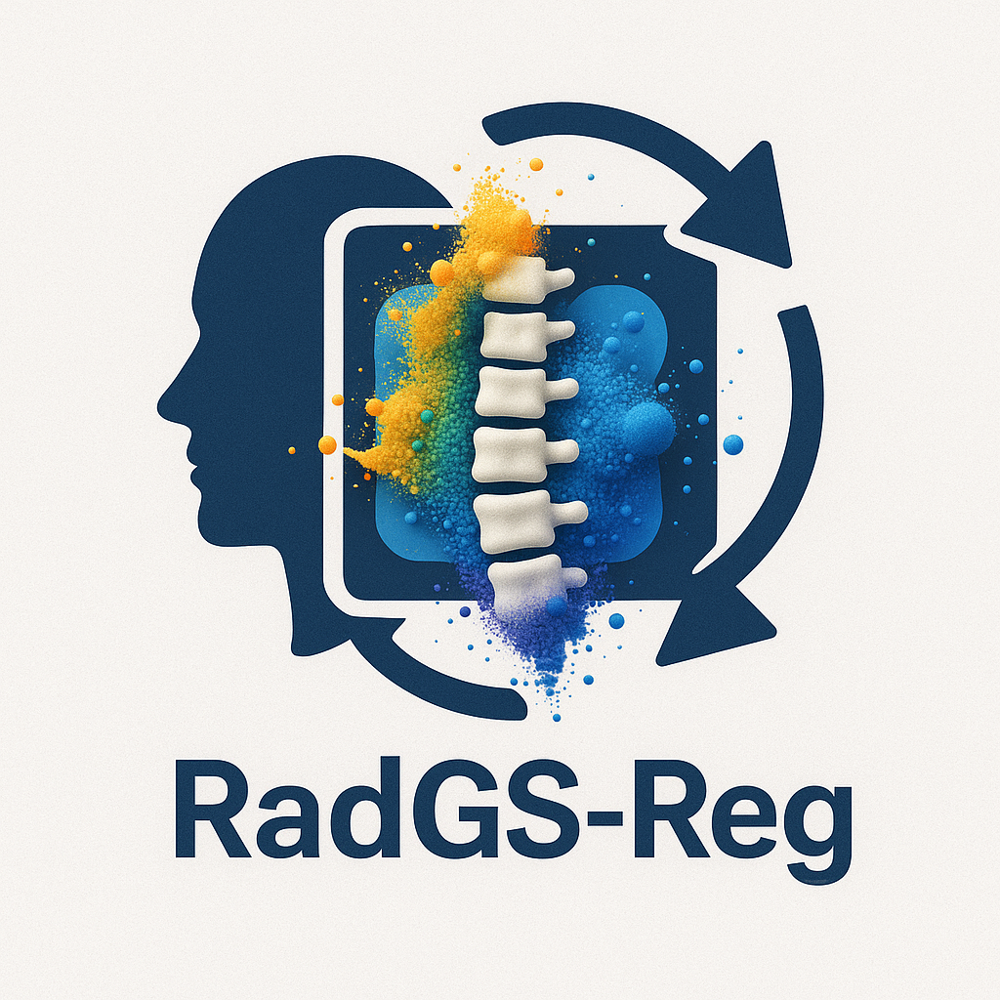
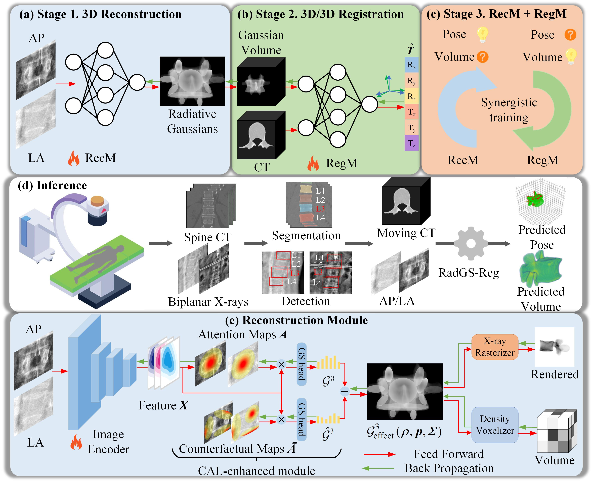

<div align="center">



[](https://shenao1995.github.io/RadGS-Reg-Homepage/)
[](https://link.springer.com/chapter/10.1007/978-3-032-05114-1_44)
[](https://huggingface.co/shenao1995)

<h2>RadGS-Reg: Registering Spine CT with Biplanar X-Rays via Joint 3D Radiative Gaussians Reconstruction and 3D/3D Registration</h2>



</div>

## 📰 News

- **2026.10.25:** [RecM](https://huggingface.co/shenao1995/RadGS-Reg-RecM), [RegM and paired joint checkpoints](https://huggingface.co/shenao1995/RadGS-Reg-RegM), and the [complete test set](https://huggingface.co/datasets/shenao1995/RadGS-Reg-Test) are available on Hugging Face.
- **2026.10.22:** We have fixed the RecM code and will upload the model and dataset to Hugging Face.
- **2026.01.30:** Code and data have been released.
- **2025.09.21:** Our work has been accepted to MICCAI 2025 **ORAL**!

## 📖 Introduction

RadGS-Reg is a framework for vertebral-level CT/X-ray registration that combines 3D Radiative Gaussians reconstruction from biplanar X-rays with 3D/3D registration.

If you find this repo useful, please give it a star ⭐ and consider citing our paper.

## 🛠️ Installation

Clone the repository:

```bash
git clone --recursive https://github.com/shenao1995/RadGS_Reg.git
cd RadGS_Reg
```

### 🐍 Reconstruction Environment

Use Linux with an NVIDIA GPU and a CUDA 11.8 toolkit.

```bash
conda create -n radgs python=3.11 pip -y
conda activate radgs

pip install torch==2.1.2+cu118 torchvision==0.16.2+cu118 \
  --index-url https://download.pytorch.org/whl/cu118
pip install numpy==1.26.4 monai==1.3.2 SimpleITK opencv-python-headless \
  scikit-learn scikit-image plyfile open3d tensorboard tensorboardX \
  matplotlib imageio pyvista pyyaml torchinfo "moviepy<2" pandas tqdm ninja
```

Install the CUDA extensions and their source dependencies:

```bash
git clone https://gitlab.inria.fr/bkerbl/simple-knn.git \
  r2_gaussian/submodules/simple-knn
git clone --branch 0.9.9.8 https://github.com/g-truc/glm.git \
  r2_gaussian/submodules/xray-gaussian-rasterization-voxelization/third_party/glm

pip install --no-build-isolation -e r2_gaussian/submodules/simple-knn
pip install --no-build-isolation -e r2_gaussian/submodules/xray-gaussian-rasterization-voxelization
```

### 🩻 Data Generation Environment

Create a separate environment for NanoDRR:

```bash
conda create -n nanodrr python=3.11 pip -y
conda activate nanodrr

pip install torch==2.6.0+cu124 --index-url https://download.pytorch.org/whl/cu124
pip install "numpy==1.26.4" SimpleITK torchio plyfile Pillow \
  "nanodrr @ git+https://github.com/eigenvivek/nanodrr.git@f10354191f1e511cadee5d7cd4fc8ad05f5964c4"
```

## 🚀 Running

Run all commands from the repository root. The examples run directly on a local NVIDIA GPU; no cluster scheduler is required. Use `CUDA_VISIBLE_DEVICES=0` to select a GPU, and reduce `--batch-size` if needed. For training from scratch, follow **Reconstruction → Registration → Joint Training** in order. These instructions target the current public point-based RegM release; it is not the original paper's CAL implementation.

### 📦 Released Models and Test Data

| Artifact | Download | Contents |
| --- | --- | --- |
| RecM | [RadGS-Reg-RecM](https://huggingface.co/shenao1995/RadGS-Reg-RecM) | `best_detail.pth` and its matching `config.json` |
| RegM / joint model | [RadGS-Reg-RegM](https://huggingface.co/shenao1995/RadGS-Reg-RegM) | `regm_best.pth` for standalone registration; `joint_best.pth` containing the paired RecM and RegM |
| Test set | [RadGS-Reg-Test](https://huggingface.co/datasets/shenao1995/RadGS-Reg-Test) | All 431 vertebral samples from 87 CT scans, original test split, registration poses and landmarks (about 14.3 GB) |

The released test set is for evaluation, not for training. Prepare separate training and validation data as described in **Generate Data**. Keep the configuration beside each downloaded checkpoint. For joint evaluation, use the paired `joint_best.pth`: the independently selected best RecM and best RegM need not come from the same epoch.

Download and evaluate the released joint model locally:

```bash
conda activate radgs
pip install huggingface_hub

python - <<'PY'
from huggingface_hub import snapshot_download

snapshot_download("shenao1995/RadGS-Reg-RegM", local_dir="checkpoints/RegM",
                  allow_patterns=["joint_best.pth", "config.json"])
snapshot_download("shenao1995/RadGS-Reg-Test", repo_type="dataset",
                  local_dir="data/released_test")
PY

python -m tools.evaluation.joint_evaluate \
  --checkpoint checkpoints/RegM/joint_best.pth \
  --data-dir data/released_test \
  --reg-data-dir data/released_test/registration \
  --split test --batch-size 1 \
  --output-dir outputs/released_joint_test
```

The registration caches included in the dataset were generated with the earlier frozen RecM; the command above recomputes reconstruction using the online RecM in the joint checkpoint. See the model cards for checkpoint provenance and recorded training settings. The training examples below describe a local training workflow, rather than a promise to reproduce the released weights exactly with a different initialization or GPU count.

### 🧩 Reconstruction

Place the prepared dataset in `data/vertebra_dataset`. Provide `splits/train.txt`, `splits/val.txt`, and `splits/test.txt`, each listing sample filenames relative to that directory. Keep all vertebrae from the same CT in one split.

Activate the reconstruction environment:

```bash
conda activate radgs
```

#### 🏋️ Training

Single GPU:

```bash
python gs_train.py \
  --data-dir data/vertebra_dataset \
  --output-dir outputs/RecM \
  --epochs 150
```

Alternatively, train on eight GPUs:

```bash
torchrun --standalone --nproc_per_node=8 gs_train.py \
  --data-dir data/vertebra_dataset \
  --output-dir outputs/RecM \
  --epochs 150
```

Monitor training with TensorBoard:

```bash
tensorboard --logdir outputs/RecM/tensorboard
```

#### 📊 Evaluation

Evaluate a trained checkpoint on the test split:

```bash
python -m tools.evaluation.evaluate_reconstruction \
  --checkpoint outputs/RecM/best_detail.pth \
  --data-dir data/vertebra_dataset \
  --split test \
  --output-dir outputs/RecM_eval
```

#### 🔍 Inference

Reconstruct and export volumes:

```bash
python gs_infer.py \
  --checkpoint outputs/RecM/best_detail.pth \
  --data-fold data/vertebra_dataset \
  --output outputs/RecM_infer
```

### 🧭 Registration

Use the `radgs` environment and the same CT-level training/validation/test split as RecM. First finish RecM training and keep `outputs/RecM/best_detail.pth` together with `outputs/RecM/config.json`.

#### 🗂️ Prepare Registration Pairs

The reconstruction dataset must also contain `samples_manifest.json` with a `samples` list. Each entry needs `filename`, `case_id`, `label`, `level`, and `split`, consistent with the split files. The preparation step preserves those splits, freezes RecM to reconstruct the fixed volumes, and creates moving CTs with known rigid perturbations (each rotation axis within ±5° and each translation axis within ±10 mm).

Run the following steps in order on one GPU:

```bash
conda activate radgs

python -m tools.data.prepare_registration \
  --data-dir data/vertebra_dataset \
  --checkpoint outputs/RecM/best_detail.pth \
  --output data/registration --mode initialize --seed 42

python -m tools.data.prepare_registration \
  --data-dir data/vertebra_dataset \
  --checkpoint outputs/RecM/best_detail.pth \
  --output data/registration --mode export --seed 42

python -m tools.data.prepare_registration \
  --data-dir data/vertebra_dataset \
  --checkpoint outputs/RecM/best_detail.pth \
  --output data/registration --mode audit --seed 42
```

Wait for export and audit to finish before training. Add `--resume` to the export command to continue an interrupted export with the same data and checkpoint. Do not mix caches produced by different RecM checkpoints. This preparation produces 96³ pairs on a shared 192 mm field of view (2 mm spacing), used by the basic local workflow below.

#### 🏋️ Train RegM

Start standalone registration training with the prepared CT/reconstruction pairs:

```bash
python Reg3D_train.py \
  --data-dir data/registration \
  --output-dir outputs/RegM \
  --epochs 40 --batch-size 1 \
  --fixed-mode curriculum --curriculum-epochs 10 \
  --lr 1e-4 --seed 42
```

The curriculum gradually changes the fixed volume from ground-truth CT to the frozen RecM reconstruction during the first 10 epochs. Training saves the validation-selected model as `outputs/RegM/best.pth`, resume state as `latest.pt`, and logs under `tensorboard/`. Use validation for checkpoint selection and reserve the test split for final evaluation.

#### 📊 Evaluate and Export

```bash
python Reg3D_infer.py \
  --checkpoint outputs/RegM/best.pth \
  --data-dir data/registration \
  --split test --fixed-mode rec --batch-size 1 \
  --export-cases 5 \
  --output-dir outputs/RegM_test
```

Use `--split val` for validation. Outputs include aggregate and per-case registration metrics (translation error in mm, rotation error in degrees, and landmark mTRE in mm). `--export-cases 5` also saves registered CT volumes and predicted/ground-truth transforms for five cases.

For a separate pair of preprocessed NIfTI volumes:

```bash
python Reg3D_infer.py \
  --checkpoint outputs/RegM/best.pth \
  --moving data/example/moving_ct.nii.gz \
  --fixed data/example/reconstructed_ct.nii.gz \
  --output-dir outputs/RegM_pair
```

Both volumes must retain their physical spatial metadata, share an initial physical frame, and contain linear attenuation values in `1/mm`, not raw HU or separately normalized intensities. Registration outputs a rigid moving-to-fixed transform in RAS millimetres and the moving CT resampled onto the fixed grid.

The released RegM uses a 192³, 1 mm input canvas. It cannot be evaluated against the 96³ cache above with `Reg3D_infer.py`. To evaluate the released paired model on the published test set, use **Released Models and Test Data** above; the local workflow here trains its own compatible 96³ model.

### 🤝 Joint Training

Finish the two standalone stages first. Use the original reconstruction dataset, its matching registration manifest/landmarks, and the selected RecM/RegM checkpoints. Keep `data/vertebra_dataset` at the path recorded when preparing `data/registration`; the joint training and export commands check that both stages use the same source data.

#### 🏋️ Train RecM and RegM Together

```bash
python joint_train.py \
  --data-dir data/vertebra_dataset \
  --reg-data-dir data/registration \
  --recm-checkpoint outputs/RecM/best_detail.pth \
  --regm-checkpoint outputs/RegM/best.pth \
  --output-dir outputs/Joint \
  --epochs 200 --batch-size 1 \
  --optimization-mode alternating --regm-warmup-epochs 5 \
  --recm-lr 1e-6 --regm-lr 1e-4 \
  --geo-weight 0.1 --point-loss-weight 1.0 --point-trim-fraction 0.9 \
  --recm-target-foreground-weight 0.5 --recm-target-roi-margin-mm 5 \
  --registration-loss-spacing-mm 1 \
  --fixed-input-rotation-noise-deg 2 \
  --fixed-input-translation-noise-mm 0.5 \
  --seed 42
```

The first five epochs keep RecM fixed while warming up RegM; the remaining epochs alternate updates of both models. Fixed-input perturbations apply only during training. Reconstruction is predicted online from the AP/lateral inputs throughout joint training and evaluation; cached fixed reconstructions are not substituted for the joint RecM output.

For multiple GPUs on one local machine, replace `python joint_train.py` with `torchrun --standalone --nproc_per_node=2 joint_train.py` and keep the remaining arguments. `--batch-size` is per GPU, so changing GPU count changes the global batch size. Use the same GPU count and training arguments for exact resume.

Monitor both standalone and joint runs:

```bash
tensorboard --logdir outputs
```

Checkpoints in `outputs/Joint`:

- `best.pth`: paired RecM/RegM selected by validation pose errors with a reconstruction SSIM penalty; use this for joint registration evaluation.
- `best_reconstruction.pth`: paired checkpoint selected by validation foreground-ROI reconstruction SSIM. It may differ from the best registration checkpoint.
- `latest.pt`: training state for resuming, including optimizer, scheduler, and random states. To resume, repeat the training command with `--resume outputs/Joint/latest.pt`; `--epochs` is the total desired epoch count, not additional epochs.

These local paired checkpoints contain both networks. Use `joint_infer.py` and the joint evaluator directly; standalone RecM inference expects a standalone reconstruction checkpoint.

#### 📊 Evaluate on Validation and Test Splits

```bash
python -m tools.evaluation.joint_evaluate \
  --checkpoint outputs/Joint/best.pth \
  --data-dir data/vertebra_dataset \
  --reg-data-dir data/registration \
  --split val --batch-size 1 \
  --output-dir outputs/Joint_val

python -m tools.evaluation.joint_evaluate \
  --checkpoint outputs/Joint/best.pth \
  --data-dir data/vertebra_dataset \
  --reg-data-dir data/registration \
  --split test --batch-size 1 \
  --output-dir outputs/Joint_test
```

Results include `evaluation.json` and per-case JSON/CSV files, covering reconstruction quality and rigid registration errors. Keep the recorded metric intensity ranges unchanged when comparing runs. Test data must not be used to choose checkpoints or tune training settings.

#### 🔍 Export Five Joint Predictions

**Using pretrained models (no training required).** After completing the `radgs` environment and CUDA extension installation, download the [paired joint model](https://huggingface.co/shenao1995/RadGS-Reg-RegM) and the [complete test set](https://huggingface.co/datasets/shenao1995/RadGS-Reg-Test) from Hugging Face. `joint_best.pth` contains both RecM and RegM; a separate RecM download is not needed. Run the following from the repository root to predict and export five test samples:

```bash
conda activate radgs
pip install huggingface_hub

python - <<'PY'
import json
from pathlib import Path
from huggingface_hub import snapshot_download

snapshot_download("shenao1995/RadGS-Reg-RegM", local_dir="checkpoints/RegM",
                  allow_patterns=["joint_best.pth", "config.json"])
snapshot_download("shenao1995/RadGS-Reg-Test", repo_type="dataset",
                  local_dir="data/released_test")

# Bind the downloaded registration metadata to this local dataset directory.
data_root = Path("data/released_test").resolve()
manifest_path = data_root / "registration" / "manifest.json"
manifest = json.loads(manifest_path.read_text())
manifest["protocol"].setdefault("source_data_at_release", manifest["protocol"]["source_data"])
manifest["protocol"]["source_data"] = str(data_root)
manifest_path.write_text(json.dumps(manifest, indent=2) + "\n")
PY

python joint_infer.py \
  --checkpoint checkpoints/RegM/joint_best.pth \
  --data-dir data/released_test \
  --reg-data-dir data/released_test/registration \
  --split test --cases 5 \
  --output-dir outputs/pretrained_joint_infer
```

The test set download is about 14.3 GB. This command runs both reconstruction and registration using the downloaded checkpoint, then writes the five cases to `outputs/pretrained_joint_infer`. Samples are selected at evenly spaced positions in the test split, without selection based on prediction quality.

**Using your own trained checkpoint.** If you completed joint training above, export five predictions with your local model and prepared registration data:

```bash
python joint_infer.py \
  --checkpoint outputs/Joint/best.pth \
  --data-dir data/vertebra_dataset \
  --reg-data-dir data/registration \
  --split test --cases 5 \
  --output-dir outputs/Joint_infer
```

Each case includes the online reconstruction, ground-truth CT, simulated moving CT, registered moving CT, transform metadata, and a comparison preview. Use these exports to inspect reconstruction and registration together.

## 🩻 Generate Data

Generate L1–L5 samples from paired CT volumes and segmentation masks using [NanoDRR](https://github.com/eigenvivek/nanodrr). For [CTSpine1K](https://huggingface.co/datasets/alexanderdann/CTSpine1K), labels 20–24 correspond to L1–L5.

```bash
conda activate nanodrr

python -m tools.data_generation \
  --ct-dir data/raw_data/volumes \
  --mask-dir data/raw_data/labels \
  --out-dir data/vertebra_dataset \
  --labels 20 21 22 23 24 \
  --spacing-mm 1.0 \
  --volume-size 128 \
  --max-source-spacing-mm 1.0 \
  --max-output-spacing-mm 1.0 \
  --device cuda \
  --backend triton
```

Each sample contains 50 DRRs over `[0°, 180°)`, with AP and lateral views as inputs. Samples with original or generated voxel spacing greater than 1 mm are excluded. After generation, prepare the CT-level split files described in **Running**.

For a single CT/mask pair, use the same settings with explicit input files:

```bash
python -m tools.data_generation \
  --ct data/raw_data/volumes/case.nii.gz \
  --mask data/raw_data/labels/case_seg.nii.gz \
  --out-dir data/single_case --labels 20 \
  --spacing-mm 1.0 --volume-size 128 \
  --max-source-spacing-mm 1.0 --max-output-spacing-mm 1.0 \
  --device cuda --backend triton
```

This produces a vertebra's `.pickle`, `.json`, and `.ply` files plus previews. Training requires multiple CTs with non-overlapping train/validation/test groups; a single case is a preprocessing check only. DRRs use cone-beam geometry (default SDD 1100 mm, DSO 800 mm, 256² detector with 1.2 mm pixels). Preserve the saved camera geometry, angles, physical volume metadata, and projection intensities; PNG previews are not training inputs.

After writing your split files, create the sample manifest needed by registration preparation from the generated sidecar metadata:

```bash
python - <<'PY'
import json
from pathlib import Path

root = Path("data/vertebra_dataset")
rows, groups, seen = [], {}, set()
for split in ("train", "val", "test"):
    filenames = (root / "splits" / f"{split}.txt").read_text().splitlines()
    for filename in filter(None, (line.strip() for line in filenames)):
        if filename in seen:
            raise ValueError(f"Duplicate sample: {filename}")
        seen.add(filename)
        meta = json.loads((root / filename).with_suffix(".json").read_text())
        case_id, label = meta["case_id"], meta["label"]
        if groups.setdefault(case_id, split) != split:
            raise ValueError(f"CT appears in multiple splits: {case_id}")
        rows.append(dict(filename=filename, case_id=case_id, label=label,
                         level=f"L{label - 19}", split=split))
manifest = dict(samples=rows,
                counts={s: sum(r["split"] == s for r in rows)
                        for s in ("train", "val", "test")})
(root / "samples_manifest.json").write_text(json.dumps(manifest, indent=2) + "\n")
PY
```

## 🙏 Acknowledgement

We thank the authors of [R²-Gaussian](https://github.com/Ruyi-Zha/r2_gaussian), [3D Gaussian Splatting](https://github.com/graphdeco-inria/gaussian-splatting), [NanoDRR](https://github.com/eigenvivek/nanodrr), [MONAI](https://github.com/Project-MONAI/MONAI), and [SimpleITK](https://github.com/SimpleITK/SimpleITK) for sharing their work.

## 📄 License

Third-party components retain their respective licenses, including the [Gaussian rasterizer and voxelizer license](r2_gaussian/submodules/xray-gaussian-rasterization-voxelization/LICENSE.md).

## 📚 Citation

If this repo helps you, please consider citing our work:

```bibtex
@inproceedings{shen2026radgsreg,
  title={RadGS-Reg: Registering Spine CT with Biplanar X-Rays via Joint 3D Radiative Gaussians Reconstruction and 3D/3D Registration},
  author={Shen, Ao and Fu, Xueming and Jiang, Junfeng and Zeng, Qiang and Tang, Ye and Chen, Zhengming and Nong, Luming and Wang, Feng and Zhou, Shaohua Kevin},
  booktitle={Medical Image Computing and Computer Assisted Intervention -- MICCAI 2025},
  series={Lecture Notes in Computer Science},
  volume={15968},
  pages={456--466},
  year={2026},
  publisher={Springer Nature Switzerland},
  doi={10.1007/978-3-032-05114-1_44}
}
```
